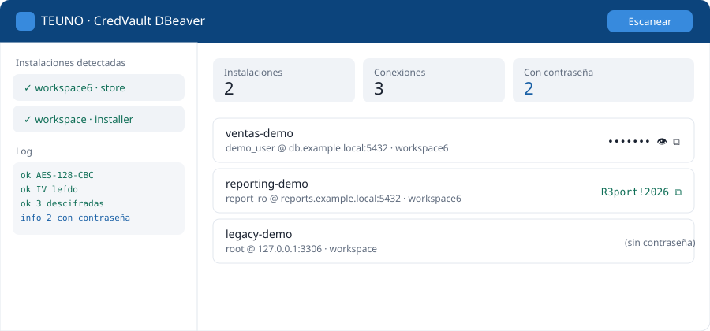
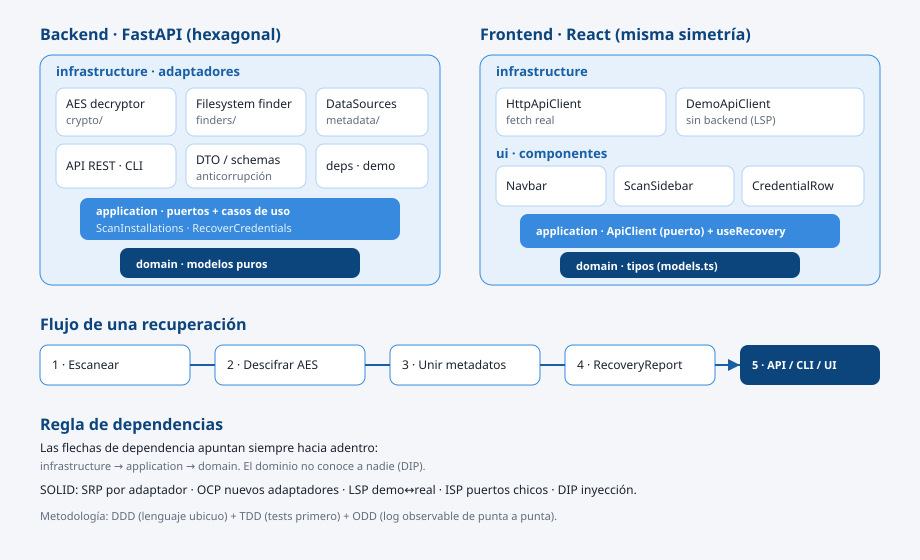

<div align="center">

# 🔐 CredVault · DBeaver Credential Recovery

**Recuperador local de credenciales de DBeaver** — construido con arquitectura **hexagonal** en
backend y frontend, principios **SOLID** y metodología **DDD + TDD + ODD**.

[](https://github.com/Alexis-VsCode/credvault-dbeaver/actions/workflows/ci.yml)
[](https://www.python.org/)
[](https://fastapi.tiangolo.com/)
[](https://react.dev/)
[](https://www.typescriptlang.org/)
[](backend/tests)
[](LICENSE)

</div>

> [!IMPORTANT]
> Herramienta para recuperar **tus propias** credenciales, en **tu propia** máquina, cuando las
> olvidaste. Lee el [DISCLAIMER](DISCLAIMER.md). El repositorio **no contiene** credenciales, hosts
> ni IPs reales: todos los datos de ejemplo son ficticios.

---

## ✨ Qué es

DBeaver Community guarda las contraseñas de tus conexiones en `.dbeaver/credentials-config.json`,
cifradas con **AES-128-CBC** y una **clave fija pública** embebida en el propio programa. CredVault
automatiza su recuperación y la presenta en una consola web clara:

1. **Escanea** todas las instalaciones de DBeaver de la máquina (Microsoft Store, instalador MSI, portable).
2. **Descifra** el almacén de cada una y lo **une** con los metadatos de `data-sources.json`.
3. **Muestra** cada conexión con nombre, host, usuario y contraseña (revelar / copiar).
4. Si un workspace usa **contraseña maestra**, lo detecta y lo informa — no falla.

<div align="center">

</div>

---

## 🧱 Arquitectura

Hexagonal y **simétrica** en los dos lados: el dominio no depende de nada; la infraestructura se
enchufa a los puertos.

<div align="center">

</div>

```
backend/src/credvault/            frontend/src/
├── domain/         modelos        ├── domain/         tipos puros
├── application/    puertos+UC     ├── application/    puerto ApiClient + useRecovery
└── infrastructure/ adaptadores    ├── infrastructure/ HttpApiClient / DemoApiClient
    ├── crypto/     AES            └── ui/
    ├── finders/    filesystem         ├── components/<Comp>/Comp.tsx + .css
    ├── metadata/   data-sources       └── pages/ConsoleView/
    ├── api/        FastAPI
    └── cli/
```

📖 Detalle en [docs/ARQUITECTURA.md](docs/ARQUITECTURA.md) ·
🧩 Patrones aplicados en [docs/PATRONES.md](docs/PATRONES.md) ·
🔬 Metodología en [docs/METODOLOGIA.md](docs/METODOLOGIA.md).

---

## 🚀 Arranque rápido

### Con Docker (demo en contenedores)

```bash
docker compose up --build
# Frontend: http://localhost:8080   ·   API: http://localhost:8000/docs
```

### Manual

<table>
<tr><th>Backend (FastAPI)</th><th>Frontend (React + Vite)</th></tr>
<tr valign="top"><td>

```bash
cd backend
pip install -e ".[dev]"
# modo real (lee tu DBeaver):
python -m uvicorn \
  credvault.infrastructure.api.main:app \
  --port 8000
```

</td><td>

```bash
cd frontend
npm install
npm run dev
# abre http://localhost:5173
```

</td></tr>
</table>

> Modo demo sin DBeaver: `CREDVAULT_DEMO=1` en el backend, o `VITE_DEMO=1` en el frontend.

### CLI

```bash
cd backend && pip install -e .
credvault           # contraseñas enmascaradas
credvault --show    # en claro
```

---

## 🧪 Calidad

| Backend | Frontend |
|---------|----------|
| `pytest -q` — 11 pruebas (dominio, cripto, casos de uso, API e2e) | `npm run typecheck` — TypeScript estricto |
| `mypy src/credvault` — tipado estático | `npm run build` — build de producción |
| `ruff check src tests` — linting | |

Integración continua con **GitHub Actions** en cada push y PR (matriz Python 3.10–3.12).

---

## 🗂️ Stack y decisiones

| Área | Elección | Por qué |
|------|----------|---------|
| Backend | FastAPI + Pydantic | Tipado, OpenAPI automático, mínimo boilerplate. |
| Cripto | `cryptography` (AES-128-CBC) | Formato real del almacén de DBeaver. |
| Frontend | React + TypeScript + Vite | Componentes tipados, build rápido. |
| Arquitectura | Hexagonal (puertos y adaptadores) | Negocio aislado y testeable. |
| Metodología | DDD · TDD · ODD | Vocabulario, pruebas primero, observabilidad. |

Lo que **no** se usó (y por qué) está documentado en [docs/PATRONES.md](docs/PATRONES.md): sin BD,
sin CQRS, sin microservicios. La regla: un patrón entra solo cuando resuelve un problema presente.

---

## 📚 Documentación

- [Manual de usuario](docs/MANUAL_USUARIO.md) · [Manual técnico](docs/MANUAL_TECNICO.md)
- [Arquitectura](docs/ARQUITECTURA.md) · [Patrones](docs/PATRONES.md) · [Metodología](docs/METODOLOGIA.md)
- [Contribuir](CONTRIBUTING.md) · [Seguridad](SECURITY.md) · [Changelog](CHANGELOG.md)

---

## 👤 Autor

**Alexis Barrera** · *MancoDev* — Full-stack / SRE · DevOps
[GitHub](https://github.com/Alexis-VsCode)

Licencia [MIT](LICENSE) © 2026.
